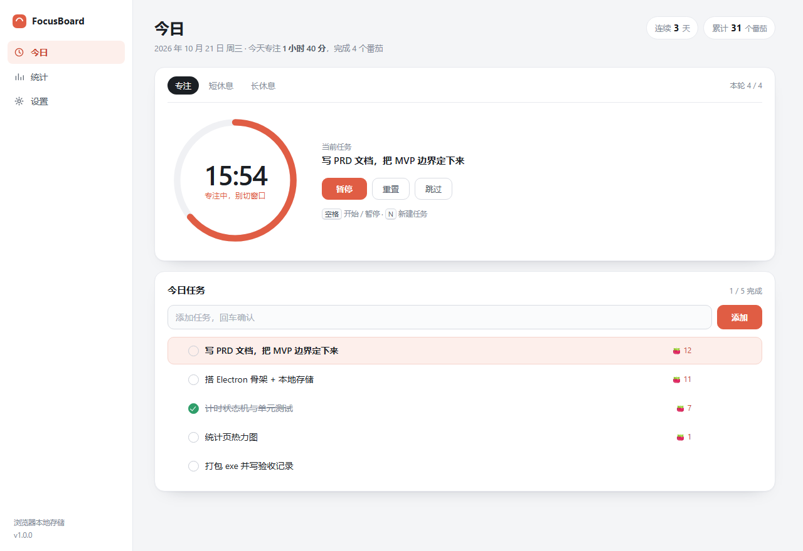

# FocusBoard

> 今日任务 + 番茄专注计时 + 专注统计，三合一。**纯本地运行的 Electron 桌面应用**，无后端、无账号、不联网。

课程项目，交付物包含三份文档（[PRD.md](./PRD.md) / [TECH_DESIGN.md](./TECH_DESIGN.md) / [AGENTS.md](./AGENTS.md)）与完整可运行代码。



## 为什么做这个

番茄工作法的门槛不在「计时」，而在**任务与计时的割裂**：任务写在一个软件、计时开在另一个网页，还得手动记一笔。FocusBoard 把「今天做什么 → 选中开始 → 自动落账 → 看得见统计」串成一个闭环。

## 功能

| 模块 | 能力 |
| --- | --- |
| 今日任务 | 新增 / 勾选 / 双击改名 / 删除 / 拖拽排序 / 设为当前 / 每任务番茄数 |
| 专注计时 | 25·5·15 三阶段，每 4 个番茄进长休息，暂停/重置/跳过，空格键开关 |
| 计时准确性 | 用**绝对结束时间戳**计算剩余，休眠、切后台、最小化都不漂移 |
| 统计 | 今日 / 近 7 天柱状图 / 近 30 天热力图 / 连续天数 / 任务分布 |
| 系统集成 | 托盘常驻 + 悬停显示剩余时间、阶段结束系统通知、关窗最小化到托盘、单实例 |
| 数据 | 原子写 JSON（临时文件 + rename），损坏自动备份并回落默认值，断网全可用 |

## 打开方式（三种，按需要选）

### ① 先看效果：浏览器预览（零安装）

双击 **`预览-浏览器打开.bat`**（或直接双击 `src/index.html`）。

界面、交互、任务与记录都能用（存在浏览器 localStorage，关掉再开数据还在），
只是没有托盘、没有系统通知——因为那是 Electron 才有的能力。适合改样式、给同学演示。

### ② 真正的桌面应用：需先装 Node.js

1. 装 Node.js LTS（免费，一次即可）：<https://nodejs.org/zh-cn>，一路下一步。
2. 双击 **`启动桌面应用.bat`**。首次会自动 `npm install`（Electron 约 100MB，需联网），装完自动开窗。

启动器会先用标准模式启动；**8 秒内没出现窗口就自动切到兼容模式**（`--no-sandbox`）重试，
并把原因打在窗口里。所以正常情况下你不需要关心这些参数。

手动运行：

```bash
cd focusboard
npm install
npm start              # 标准模式
npm run start:compat   # 兼容模式（关闭 Chromium 沙箱），标准模式起不来时用
npm run start:diag     # 带 Chromium 日志启动，排查用
```

> 国内网络装得慢，先切镜像：
> ```bash
> npm config set registry https://registry.npmmirror.com
> set ELECTRON_MIRROR=https://npmmirror.com/mirrors/electron/
> ```

### ③ 打包成 exe（发给别人用）

```bash
npm run dist
```

产物在 `dist/`：`FocusBoard Setup 1.0.0.exe`（安装版）+ 免安装的 `FocusBoard 1.0.0.exe`。
免安装版可以拷进 U 盘，双击即开。

## 开发命令

```bash
npm run start   # 开发运行
npm run test    # 纯逻辑单测（node --test，28 个用例，不需要 electron）
npm run dist    # 打包
```


## 目录

```
focusboard/
├─ electron/
│  ├─ main.js            主进程：窗口 / 托盘 / 通知 / JSON 持久化（唯一写盘者）
│  └─ preload.js         contextBridge 白名单，渲染层拿不到 ipcRenderer
├─ src/
│  ├─ index.html
│  ├─ styles.css         全部颜色/圆角走 CSS 变量
│  ├─ app.js             视图渲染 + 事件 + 250ms 主循环
│  └─ lib/
│     ├─ timer.js        计时状态机（纯函数，UMD 双栖：浏览器 window.FB / Node require）
│     ├─ stats.js        统计聚合（纯函数，now 由调用方传入）
│     └─ store.js        存储适配：Electron IPC → localStorage → 内存
├─ tests/                node --test 单元测试
├─ dev/cdp-check.mjs     可选的 CDP 冒烟测试（见下）
├─ build/                图标（icon.png / tray.png）
└─ docs/                 界面截图
```

## 设计要点（答辩可以讲的三件事）

### 1. 计时为什么不用 `setInterval` 累加

```js
remaining = Math.max(0, Math.ceil((endsAt - now) / 1000));
```

`endsAt` 是开始时就写死的绝对时间戳。哪怕主循环被浏览器节流到 1 次/分钟、系统休眠 10 分钟、
进程被杀掉再打开，算出来的剩余时间都等于真实经过时间。累加式写法（`seconds--`）在这些场景下必崩。

### 2. 纯逻辑与界面分离

`lib/timer.js`、`lib/stats.js` 不碰 DOM、不调 `Date.now()`，`now` 一律由调用方传入
→ 可以在 Node 里冻结时间做单测（28 个用例覆盖暂停/休眠/长休息轮转/时区边界/连续天数）。
同一份文件在浏览器里是 `window.FB.timer`，在测试里是 `require('../src/lib/timer.js')`。

### 3. 数据"永远不会打不开"

写入用 `临时文件 → rename` 原子替换；读取解析失败时把损坏文件改名成 `focusboard.json.corrupt-<ts>`
并回落默认值。宁可丢历史数据，也不能让应用起不来。

## 验证情况

- `npm run test`：**36 / 36 通过**（计时状态机 15 + 统计 13 + 主进程 8）
- 主进程那一组用假的 `electron` 模块加载 `electron/main.js`，验证了窗口安全选项、托盘菜单、
  `db:save`/`db:load` 原子写入、损坏文件备份回落、通知与托盘文案去抖、关窗不退出
- 用 Chrome DevTools Protocol 驱动真实页面跑了 17 项交互冒烟（开始/暂停/重置/新增任务/勾选/到期自动结算/统计页/设置生效），**全部通过、无 console 报错**
- 视觉：三个视图均已截图核对（见 `docs/`）

> 说明：本项目的 GUI 窗口需要交互式桌面会话，CI / 沙箱环境里 `app.whenReady()` 不会返回，
> 属于环境限制。主进程逻辑因此改用了上面的桩测试覆盖。

## 常见问题

**`npm start` 没窗口，但 `npm run start:compat` 有**

这台机器上 Chromium 的沙箱初始化被拦住了（`npm run start:diag` 可以看到 `crashpad_client_win` /
`process_singleton_win` 一类报错）。用 `node dev/doctor.mjs` 诊断过：默认、关闭 GPU、关闭 GPU 沙箱
等组合都无法让渲染进程起来，只有 `--no-sandbox` 可以。

- 启动器 `启动桌面应用.bat` 会自动降级，双击即可；
- 手动跑请用 `npm run start:compat`；
- `--no-sandbox` 关闭的是 Chromium 的进程沙箱。本应用不加载任何远程页面、`contextIsolation` 保持开启、
  只通过白名单 IPC 访问本地文件，所以这个模式不影响数据安全。

**双击启动器后没反应、窗口不出来**

按这三步定位（启动器已自动做前两步）：

1. 看 `.userdata\startup.log` 是否生成。
   - **没有这个文件** → 崩在 Electron 初始化阶段，早于应用代码，试 `npm run start:compat`。
   - **写了 `lock=failed`** → 数据目录不可写，见下一条。
   - **写了 `lock=ok`** → 应用已启动，问题在窗口层面，把日志发我。
2. 日志里出现 `process_singleton_win.cc: Lock file can not be created! Error code: 5`
   说明 Chromium 无法在数据目录创建单实例锁。本项目已规避：**源码运行时数据目录是项目内的 `.userdata`**，
   打包后才用 `%APPDATA%\FocusBoard`。也可以自己指定：`set FOCUSBOARD_DATA_DIR=%TEMP%\FocusBoard`。
3. 需要更详细的输出：`npm run start:diag`（带 Chromium 日志）或 `node dev\doctor.mjs`（自动体检）。


**`npm install` 之后启动报 `Cannot read properties of undefined (reading 'setAppUserModelId')`**
说明 Electron 是以 Node 模式跑起来的。检查环境变量 `ELECTRON_RUN_AS_NODE` 是否被设成了 `1`，
清掉再启动；某些 IDE / 打包工具会注入这个变量。

**`npm install` 提示 `install scripts not yet covered by allowScripts`**
npm 11 默认拦截依赖的安装脚本，Electron 的二进制没下载。启动器已内置补救逻辑；手动执行：

```bash
cd node_modules/electron
set ELECTRON_MIRROR=https://npmmirror.com/mirrors/electron/
node install.js
```

**窗口关掉后应用还在后台**：这是特性不是 bug，去托盘图标上右键「退出 FocusBoard」，
或在设置里关掉「关闭窗口时最小化到托盘」。


### 想自己跑一遍冒烟测试

```bash
# 1. 起一个静态服务（任选）
python -m http.server 8765
# 2. 用 Chrome 打开 http://127.0.0.1:8765/src/index.html，带调试端口
chrome --headless=new --remote-debugging-port=9222 --remote-allow-origins=* \
       --user-data-dir=/tmp/fb http://127.0.0.1:8765/src/index.html
# 3. 另开终端
node dev/cdp-check.mjs
```

## 已知边界

- 没有多设备同步（PRD 明确不做），换电脑要手动拷 `%APPDATA%/FocusBoard/focusboard.json`。
- 未做代码签名，首次运行 SmartScreen 提示「更多信息 → 仍要运行」。
- 托盘图标在部分 Linux 桌面环境可能不显示（Electron 的已知行为），Windows 正常。
